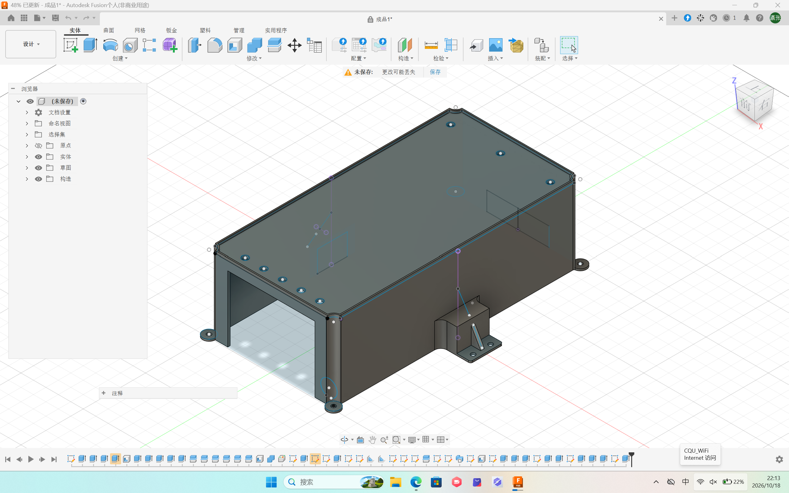
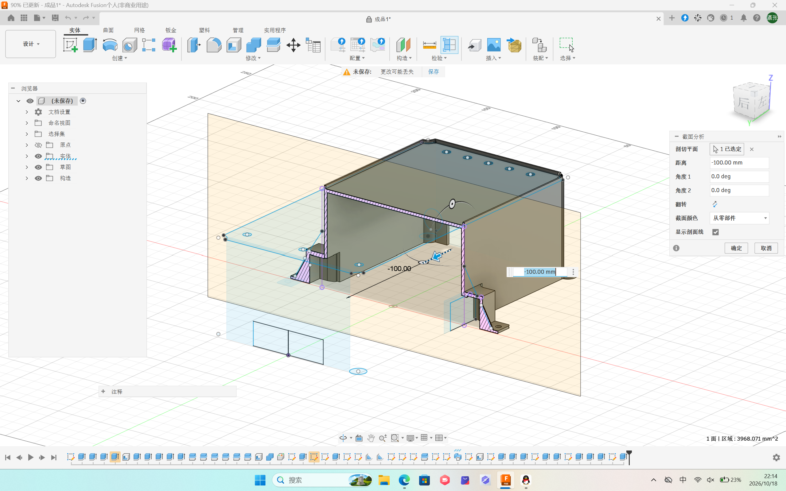

# 嘉礼战队 CRTC2026 中期考核技术文档

> **队伍名称**：嘉礼战队（jiali）  
> **实训战队**：千里战队  
> **参赛组别**：新生组  
> **机器人方案**：一台车，使用采购清单中的底盘，STM32F103C8T6 作为主控，除降压模块与电池与官方采购清单不同，其余配件均相同  
> **文档整理时间**：2026 年 10 月 16 日

| 模块      | 方案                                               |
| ------- | ------------------------------------------------ |
| 主控      | STM32F103C8T6，CubeMX + Keil + VSCode 开发          |
| 底盘      | 物资表金属折弯底盘 + 4×TT 马达，麦轮 X 形布置，双 H 桥电机驱动板×2        |
| 遥控      | 官方指定 PS2 无线手柄，软件 SPI 通信                          |
| 机械臂     | 2×MG995（关节）+ 2×SG90（臂底盘、机械爪），TIM2/TIM3 共 4 路 PWM |
| 外壳      | 3D 打印 PLA 外壳（Creality K1 Max）                    |

## 整体开发时间线（从早到晚）

| **日期**        | **完成事项 / 日志记录**                                                                      |
| --------- | ----------------------------------------------------------------------- |
| **9 月 14 日**  | 报名，分组                                                                   |
| **9 月 16 日起** | 开始学习 C 语言、STM32 单片机及相关开发工具                                            |
| **9 月 26 日**  | 参加组会，明确机器人方案与分工                                                                      |
| **9 月 27 日**  | 购买各类配件                                                                  |
| **国庆节期间**     | 学习与拼装，完成 PS2 手柄驱动与底盘八向移动的代码编写                                           |
| **10 月 6 日**  | 完成 PS2 手柄通信驱动的基础代码编写                                                    |
| **10 月 7 日**  | 开始实现底盘八向移动，并完成基础运动功能                                                    |
| **10 月 8 日**  | 整车初步拼装固定                                                                |
| **10 月 9 日**  | 机械臂初步拼装，并开始进行舵机控制调试                                                     |
| **10 月 10 日** | 视频通话检查问题，发现降压模块发烫；整车调试中发现供电电压过高导致一块电机驱动模块烧坏，开始尝试使用两个降压模块分路供电，并购买另外的降压模块 |
| **10 月 11 日** | 机械臂与小车再次调试，使用万用表检测供电电压与线路，继续排查供电和通信问题                                  |
| **10 月 12 日** | 舵机有异响但不影响操控；发现电池供电不足，购买另外的电池                                            |
| **10 月 15 日** | 完成外壳建模与切片参数设置，整机代码终版定型                                                    |
| **10 月 16 日** | 整理中期考核技术文档                                                              |
| **10 月 18 日** | 完成外壳实际打印，实际打印用时约 5 小时 57 分                                      |

备赛过程中遇到的硬件问题汇总：ST-Link 烧录失败疑似成砖；面包板插线插错；板子与驱动模块或降压模块接触导致短路；电压过高导致一块电机驱动模块烧坏；轮子动力不足时转时不转；机械臂爪子自动复位；手柄与接收器时常断连导致机械臂控制故障等。这些问题的排查与解决过程分别具体记录在下文 PS2 驱动、底盘移动、整车供电与机械臂控制各节中。

## 备赛学习与技术准备

**9 月 16 日起：开始基础学习。** 在备赛初期我先学习了 C 语言、stm32 单片机 HAL 库开发、基础通信协议（I2C、SPI 等）、基础电路知识以及相关软件（keil5、cubeMX）的使用。

**9 月 16 日至 9 月 26 日：配置开发环境。** 在开始电控学习前，我先配置了 cubeMX+keil+vscode 的整体环境：利用 cubeMX 进行初始配置，keil 进行编译与调试，vscode 进行代码的编辑与 AI 的使用，然后获取了 HAL 库相关配置。

**国庆节期间：结合拼装进行专项学习。** 车辆组装中我结合网络与参考手册学习了利用 PWM 使舵机转动相应角度、PS2 手柄与单片机的 SPI 通信协议与 9 字节通信内容、如何使用电机驱动板驱动马达、麦轮的运动学解算与 8 向移动的实现、机械臂各关节的操控，以及利用 Fusion 360 对车身外壳进行建模、切片和打印。

## PS2 手柄通信驱动

### 功能描述

利用 SPI 通信协议实现手柄按键按下和摇杆推动时能在单片机端接收到相关信息，以此实现远程遥控功能。

### 开发历程

**10 月 5 日前：完成通信协议与开发基础学习。** 在这之前完成了 PS2 手柄通信协议、STM32 GPIO 和软件 SPI 等基础内容的学习。

**10 月 6 日：开始编写 PS2 通信驱动。** 正式建立通信测试工程，并根据手册逐步确认接收器引脚、通信时序和数据包格式。

从商家拿到数据手册后先总览了一遍内容，先找到了接收器引脚部分，发现有 4 根引脚与通信有关。考虑到后续需要使用时钟与 UART，我将这四根引脚利用杜邦线分别接到了 PB3 到 PB6，并且预留 USART1 的两个引脚作为串口通信用来测试接收效果：

| 信号           | 引脚         | 方向    | 配置     |
| ------------ | ---------- | ----- | ------ |
| CLK（时钟）      | PB3        | 主机→从机 | 推挽输出   |
| CS（片选）       | PB4        | 主机→从机 | 推挽输出   |
| CMD（命令）      | PB5        | 主机→从机 | 推挽输出   |
| DAT（数据）      | PB6        | 从机→主机 | 上拉输入   |
| USART1 TX/RX | PA9 / PA10 | 调试串口  | 115200 |

然后根据通信协议得知主机拉低 CS 时开始输出，接收器与单片机会在 CLK 下降沿时读取 CMD/DAT 上的一位数据，收集完一个字节后拉高 CS 完成一次通讯。由此我设计出了 9 个字节的包：

| 字节 | 主机 → 手柄 | 手柄 → 主机 | 含义   |
| -- | ------- | ------- | ---- |
| 1  | 0x01    | 无回复     | 通信开始 |
| 2  | 0x42    | 手柄 ID   | 请求数据 |
| 3  | 0x00    | 0x5A    | 就绪应答 |
| 4  | 0x00    | 按键数据 1  | 无回复  |
| 5  | 0x00    | 按键数据 2  | 无回复  |
| 6  | 0x00    | 右摇杆 X 轴 | 无回复  |
| 7  | 0x00    | 右摇杆 Y 轴 | 无回复  |
| 8  | 0x00    | 左摇杆 X 轴 | 无回复  |
| 9  | 0x00    | 左摇杆 Y 轴 | 无回复  |

按照这个数据包，我开始写相关代码。建立了 PS2.c 与 PS2.h 文件进行封装，考虑到要将 CS 拉低开始通信与 CLK 下降沿读取信息，建立了 `PS2_Init()` 函数来初始化。然后建立 `PS2_Transfer()` 函数进行一个字节的信息接收与传递，里面利用 8 次循环与 `msg&(0x01<<i1)` 将数据挂在 CMD 上然后拉低 CLK 发送，同时利用 `receive_data|=(0x01<<i1)` 接收数据，并返回接收到的值：

```c
uint8_t PS2_Transfer(volatile uint8_t msg)
{
    uint8_t i1=0;
    volatile uint8_t receive_data=0;
    Write(GPIOB,PS2_CMD_Pin,LOW);
    for(i1=0;i1<8;i1++)
    {
        Write(GPIOB,PS2_CMD_Pin,(msg&(0x01<<i1))?GPIO_PIN_SET:GPIO_PIN_RESET);
        //将数据放在CMD上
        delay_us(5);
        Write(GPIOB,PS2_CLK_Pin,LOW);//拉低时钟线，产生下降沿发送数据,并且接收数据(将数据的一位放在DAT上)
        delay_us(5);
        Write(GPIOB,PS2_CLK_Pin,HIGH);//拉高时钟线
        if(Read(GPIOB,PS2_DAT_Pin))receive_data|=(0x01<<i1);//接收数据
    }
    return receive_data;
}
```

之后建立 `PS2_Start(uint8_t *button, uint8_t *joystick, int8_t *value, int8_t *value2)` 用来完成一个数据包的通信，通过在里面 9 次调用 PS2_Transfer() 进行接收与发送，并通过传入数组地址来将数据存储在 main.c 中的数组中。

### 遇到的问题与解决方法

**问题 A：** 将接收器正确连接后发现手柄无法与接收器正常配对，经历多次重新烧录后再次通电但始终无法连接。

**解决方案：** 后发现商家的另一份手册，根据手册在通电后按下接收器上小孔中的按键后成功连接。

**问题 B：** 在解决 A 后发现是连不上手柄，经多次调试后发现，手柄与接收器连接需要一定时间。

**解决方案：** 在 main.c 的循环中添加延时，但当延时时间过长时阻塞感强，不够灵敏；当延时时间短时又容易断联。经过多次测试后选择延时 50ms，此时较为灵敏且通信基本稳定。终版主循环如下：

```c
while (1)
{
    PS2_Start(arr1,arr2,arr3,arr4);
    movement(arr1);                          //底盘运动
    arm_ArmOperation(arr3);                  //机械臂两个关节
    arm_ChassisOperation(arr4);              //机械臂底盘转动
    arm_ClawOperation((arr1[8]<<1|arr1[9])); //机械爪开合
    HAL_Delay(50);
}
```

**问题 C：** 建立好初版 PS2_Init() 时利用串口与电脑通讯，发现返回值与预期错误，在重新阅读手册后发现在 PS2_Transfer() 中读取数据与放数据需要延迟时间。

**解决方案：** 先用 HAL_Delay() 延迟 1ms 发现依旧有问题，询问 AI 后发现延迟时间应在 us 级，因此加上 DWT_Init() 延迟 5us 后红灯模式下通讯正常：

```c
void DWT_Init(void)
{
    CoreDebug->DEMCR |= CoreDebug_DEMCR_TRCENA_Msk;
    DWT->CYCCNT = 0;
    DWT->CTRL |= DWT_CTRL_CYCCNTENA_Msk;
}
void delay_us(uint32_t us)
{
    uint32_t start = DWT->CYCCNT;
    uint32_t cycles = us * (SystemCoreClock / 1000000);
    while ((DWT->CYCCNT - start) < cycles);
}
```

**问题 D：** 测试时发现红灯模式正常但绿灯模式摇杆返回值均为 00，几次读代码后无果。

**解决方案：** 在网上学习 keil 调试代码后通过打断点的方式发现在接收摇杆数据时内外两个循环共用了一个 i，将内循环改为 i2 后恢复正常。

**问题 E：** 利用面包板与杜邦线的结构极易在物理层面上断开。

**解决方案：** 后续将接线固定并换成更可靠的连接方式后解决。

### 功能的升级与迭代

**迭代 ①（摇杆分区解析放在哪一层）**：在加入机械臂后，发现原有返回列表的形式难以达成根据摇杆推的不同区间实现不同速率的机械臂舵机转动。此时我有三个方案，一个是根据返回的值在 main.c 中实现判断然后操作，但这会让 main.c 的内容变得冗杂，不利于代码管理因此否决；其次是在舵机程序中进行判断，但该情况下需传多个参，让舵机函数的形参变得复杂因此否决；最终选择在 PS2_Start() 中判断然后根据传入数组的地址，直接修改在 main.c 中数组的值再传入舵机函数中完成相关功能。也就是在驱动里直接把摇杆模拟值分成 -3 到 3 七个档位：

```c
//摇杆量化：上/左为正，推到底3 中间2 偏中心1 未推0
if(joystick[num[i2]]<0x85 && joystick[num[i2]]>0x75){value[i2]=0;}   //死区
else if(joystick[num[i2]]<=0x2B){value[i2]=3;}                       //推到底
else if(joystick[num[i2]]>0x2B && joystick[num[i2]]<=0x55){value[i2]=2;}
else if(joystick[num[i2]]>0x55 && joystick[num[i2]]<=0x75){value[i2]=1;}
else if(joystick[num[i2]]>0x85 && joystick[num[i2]]<=0xAB){value[i2]=-1;}
else if(joystick[num[i2]]>0xAB && joystick[num[i2]]<=0xD5){value[i2]=-2;}
else if(joystick[num[i2]]>0xD5 && joystick[num[i2]]<=0xFF){value[i2]=-3;}
```

**迭代 ②（通信异常处理）**：在初版函数中未实现当遇到 ID 错误或手柄 0x5A 发送异常情况下的异常处理，使在实际测试时会出现信号错误与断联的情况，因此在接收第三个字节后会进行相关判断，若接收出错则立刻停止通信，并清空已接收的值：

```c
mode=PS2_Transfer(0x42);          //读模式ID
ready_flag=PS2_Transfer(0x00);    //读就绪应答
if(!(ready_flag==0x5A) || (mode != 0x41 && mode != 0x73 && mode != 0x79))
{
    mode=0;
    for(i2=0;i2<16;i2++) button[i2]=0;    //清空按键
    for(i2=0;i2<4;i2++)  joystick[i2]=0;  //清空摇杆
    Write(GPIOB,PS2_CS_Pin,HIGH);         //立刻结束本次通信
    return ;
}
```

**迭代 ③（红灯模式跳过摇杆接收）**：在完成两次迭代进行终版调试中发现，若处于红灯模式下无需进行摇杆模拟值的接收，以达到更稳定与快捷的效果，因此增加判断，当 ID 为红灯模式时直接跳过对摇杆模拟值的接收：

```c
if(mode == 0x73 || mode == 0x79)
{
    for(i2=0;i2<4;i2++)
    {
        joystick[i2]=PS2_Transfer(0x00);  //仅在绿灯(模拟)模式下接收4字节摇杆值
    }
}
```

## 底盘八向移动

### 功能描述

当接收到手柄数据时，单片机输出电平给电机驱动板，实现马达的转动，将麦轮以 X 形连上马达，根据其正常运行时的向量实现米字形八向移动与原地转圈。

### 开发历程

**10 月 6 日：完成手柄通信基础功能。** 在完成手柄通讯后，开始准备底盘运动控制所需的按键映射和电机控制接口。

**10 月 7 日：开始实现底盘八向移动。**

拿到麦轮后先将其安装在 TT 马达上，然后我开始学习麦轮的基础运动学原理，运用矢量合成成功达成基础 8 向运动的方案。然后我将电机驱动板与单片机连接，将 PA0 到 PA7 的引脚设置为推挽输出连接上电机驱动板的 A1 到 D2：

| 电机     | 控制引脚      |
| ------ | --------- |
| 电机一（A） | PA0 / PA1 |
| 电机二（B） | PA2 / PA3 |
| 电机三（C） | PA4 / PA5 |
| 电机四（D） | PA6 / PA7 |

完成电路连接与规划后，我开始进行代码的编写。我先建立 Motor.c 与 Motor.h 进行封装，为了简化代码，我利用宏定义将写引脚操作宏定义为 Write()，并将 PA0 与 PA7 的引脚命名为 AO1 到 DO2。然后我创建了 11 个分别表示不同方向与停止的函数，并将它们包含在头文件中。以前进为例，就是 8 个引脚的一组高低电平：

```c
void Motor_Forward()
{
    Write(GPIOA,one_AO1_Pin,HIGH);
    Write(GPIOA,one_AO2_Pin,LOW);

    Write(GPIOA,two_BO1_Pin,HIGH);
    Write(GPIOA,two_BO2_Pin,LOW);

    Write(GPIOA,three_CO1_Pin,HIGH);
    Write(GPIOA,three_CO2_Pin,LOW);

    Write(GPIOA,four_DO1_Pin,HIGH);
    Write(GPIOA,four_DO2_Pin,LOW);
}
```

在 main.c 中建立运动函数根据手柄传入的按键信息利用多个 if-else if 语句判断并执行功能。此时车能根据摇杆进行相应操作，基本功能成功实现。

### 遇到的问题与解决方法

**问题 A：** 最初时麦轮安装的方向有问题，在进行测试时与推演的结果不一致。

**解决方案：** 之后发现我的方案需要麦轮呈 X 形分布，改变麦轮安装后成功实现功能。

### 功能的升级与迭代

底盘的运动决策代码前后写了三版，正好记录了每次简化的过程。

**迭代 ①（if-else 长链 → 函数指针表 + switch-case）**：我发现用多个 if-else if 语句极为繁琐且难以维护，初版每个方向都要把 4 个按键的状态完整写一遍，一共 47 行：

```c
//初版（节选）
if(button[4]==1&&button[5]==0&&button[6]==0&&button[7]==0)
    { move[UP](); }
else if(button[4]==0&&button[5]==1&&button[6]==0&&button[7]==0)
    { move[RIGHT](); }
else if(button[4]==1&&button[5]==1&&button[6]==0&&button[7]==0)
    { move[UPRIGHT](); }
/* ...... */
```

试想能否用 switch-case 语句进行替换，同时 Motor.c 中的 11 个函数即为类似，因此我想到利用函数指针数组创建转移表 `(*move[11])(void)`，将函数地址全部存入该数组中，并将这 11 个方式在 .h 中宏定义为对应的 0 到 10，实现封装：

```c
//Motor.h
extern void (*move[11])();
#define UP    0
#define DOWN  1
#define LEFT  2
#define RIGHT 3
/* ...... */
#define STOP  10

//Motor.c
void (*move[11])(void) ={
    Motor_Forward,Motor_Backward,Motor_Left,Motor_Right,
    Motor_ForwardLeft,Motor_ForwardRight,Motor_BackwardLeft,Motor_BackwardRight,
    Motor_TurnLeft,Motor_TurnRight,Motor_Stop
};
```

在 main.c 的运动函数中，先将手柄方向键 4 个按键的值装到一个 uint8_t 的数 direction 中，然后用 switch-case 语句达到每个 direction 对应一个运动方向，成功将代码实现简化：

```c
//第二版：位编码+switch-case
//button[7]:左 button[6]:下 button[5]:右 button[4]:上
uint8_t direction={button[4]<<0 | button[5]<<1 | button[6]<<2 | button[7]<<3};
switch(direction)
{
    case 0x01: move[UP](); break;
    case 0x02: move[RIGHT](); break;
    case 0x04: move[DOWN](); break;
    case 0x08: move[LEFT](); break;
    /* ...... */
}
```

**迭代 ②（switch-case → 查表法）**：但此时由于左右原地转我设定的为左右肩键，因此依旧要用 if 语句，并且此时 switch 依旧比较复杂，我试着看能否进一步简化，一个想法在我的脑子里出现，direction 对应一个数，能否让这个数与函数指针数组中的位置对应，达到将 direction 放到数组 [] 中直接调用，在 AI 的帮助下，我学到了查表的方法，建立了一个运动表 direction_action[16] 将 direction 的实际占有 4 位变为 0 到 15 这 16 个值，然后将每个值对应宏定义中的方位，将其余的错误按键组全部设定为 STOP：

```c
//建立方位运动表
//direction 0  0  0  0
//          左 下 右 上
static const uint8_t direction_action[16]=
{
    STOP,      //0000 0x00
    UP,        //0001 0x01
    RIGHT ,    //0010 0x02
    UPRIGHT,   //0011 0x03
    DOWN,      //0100 0x04
    STOP,      //0101 0x05
    DOWNRIGHT, //0110 0x06
    STOP,      //0111 0x07
    LEFT,      //1000 0x08
    UPLEFT,    //1001 0x09
    STOP,      //1010 0x0A
    /* ...... */
};
//建立转向运动表
// 0  0
// R1 L1
static const uint8_t turn_action[4]=
{
    STOP,       //00 0x00
    TURNLEFT,   //01 0x01
    TURNRIGHT,  //10 0x02
    STOP        //11 0x03
};
```


在调用函数时用 `move[direction_action[direction]]()` 达到简化效果，对转动采取同样的方法，同样实现效果，此时代码得到极大简化：

```c
void movement(uint8_t *button)
{
    uint8_t direction={button[4]<<0 | button[5]<<1 | button[6]<<2 | button[7]<<3};
    if(direction != 0)
    {
        move[direction_action[direction]]();
        return;
    }
    uint8_t turn = {button[10]<<0 | button[11]<<1};
    if(turn != 0)
    {
        move[turn_action[turn]]();
        return;
    }
    move[STOP]();
}
```

## 机械臂运动控制

### 功能描述

该机械臂有 4 个自由度，手柄左摇杆与右摇杆上下推动时控制机械臂两个关节的运动，左右扳机（L2/R2）控制机械臂张与关，左摇杆左右推动时控制机械臂底盘转动，整体上能通过 ps2 手柄控制机械臂移动与抓取。

### 开发历程

**10 月 9 日：完成机械臂初步拼装并开始调试。** 在机械臂的 3d 打印件到了后，先对机械臂进行了组装，最开始时，我们打算只做一个三自由度的机械臂，一个舵机用于上下动，一个舵机用于空间中前后动，一个舵机用于控制机械臂张与闭。

由于舵机的转动角度与 PWM 波的占空比有关，因此先将这三个舵机分别接到时钟二的通道 1、3、4（PA15/PB10/PB11），由于时钟 2 挂载的总线为 72Mhz，因此先对时钟进行 71 分频使每次计数设定为 1us，根据数据手册将其周期设定为 20ms，初始运行时间设置为 1.5ms：

```c
htim2.Init.Prescaler = 71;        //72MHz/72=1MHz，计一次数1us
htim2.Init.Period    = 20000-1;   //20ms周期=50Hz舵机标准信号
//比较值500~2500对应脉宽0.5~2.5ms，覆盖舵机全程
```

机械臂基本机械结构与舵机装好后开始代码的编写。大体构想为将摇杆单方向的推动的模拟值分为三个区域，三个区域控制舵机转动速率分为快中慢三区，以实现精准控制。建立 arm.c 与 arm.h 文件进行初步封装，创建初始化函数 arm_Init() 设定初始 pwm 值并开启时钟计数。然后建立函数 `arm_ArmOperation()`，形参接收传入的操作值，根据不同的操作值对控制机械臂移动的两个时钟的 pwm 参数进行修改，以达到使机械臂移动的效果。每档推力对应一个步长，每 50ms 走一步，并对脉宽做了 500 到 2500 的限幅，防止异常值让舵机转出极限：

```c
void arm_ArmOperation(int8_t *opt)
{
    static uint16_t pwm[2]={1500-1,1500-1};  //两关节初始脉宽1.5ms
    uint8_t k=0;
    for(k=0;k<2;k++)
    {
        if(opt[k]>0)  //摇杆正向推：三档步长11/33/55
        {
            switch(opt[k])
            {
                case 1: if(pwm[k]+11<=2500-1)pwm[k]+=11; else pwm[k]=2500-1; break;
                case 2: if(pwm[k]+33<=2500-1)pwm[k]+=33; else pwm[k]=2500-1; break;
                case 3: if(pwm[k]+55<=2500-1)pwm[k]+=55; else pwm[k]=2500-1; break;
                default: break;
            }
        }
        else if(opt[k]<0)  //反向同理，下限500
        { /* ...... */ }
        __HAL_TIM_SET_COMPARE(&htim2,channel[k],pwm[k]);
    }
}
```

建立函数 `arm_ClawOperation()`，根据传入的数值用于控制使机械臂的爪子开与闭。

### 遇到的问题与解决方法

**问题 A：** 最初版代码在控制爪子张开时会让手柄断连或退出绿灯模式。

**解决方案：** 经过检查 PS2 手柄连接部分的硬件与软件后确认 PS2 手柄方面无问题；之后将其余的舵机与爪子部分的舵机交换后依旧存在，然后将其余舵机的控制线与爪子舵机控制线交换后，发现问题转移到关节部分舵机运动让手柄断连，于是发现是爪子机械结构不能让该舵机转到相应角度，堵转时会把电源电压拉低使 PS2 断连。调整舵机张开角度后问题解决，对应地把爪子的行程参数从初版的 500~~1500 改成了 2000~~2500：

```c
void arm_ClawOperation(uint8_t opt)
{
    switch(opt)
    {
        case 1: __HAL_TIM_SET_COMPARE(&htim2,channel[2],2000-1); break; //设为最小
        case 2: __HAL_TIM_SET_COMPARE(&htim2,channel[2],2500-1); break; //设为最大
        default: break;
    }
}
```

**问题 B：** 最初版代码在摇杆无操作时机械臂的关节会自己朝一个方向动。

**解决方案：** 在与关节另外一个舵机交换控制线后发现另一个舵机变得会自己动，原来的舵机不会动，因此排除了舵机的问题；再利用预留的 USART 将手柄按键值返回到电脑上后发现，当右摇杆归中时返回值并不完全为 0x80，将死区扩大后该问题解决，也就是 PS2 驱动一节迭代 ① 里量化代码的第一行判断。

### 功能的升级与迭代

**迭代（增加机械臂底盘的第 4 自由度）**：为提升机械臂的操作范围和抓取灵活性，决定增加一个机械臂底盘让其能转动。在 arm.c 中加入 arm_ChassisOperation() 函数，其具体实现与关节部分舵机运动相同，只需复制关节部分主体并做小修改即可，重新配置 cubeMX 启用时钟三的通道 3（PB0），将舵机控制线连接在该引脚上，成功实现该功能：

```c
void arm_Init()
{
    HAL_TIM_PWM_Start(&htim2,TIM_CHANNEL_1);  //关节1
    HAL_TIM_PWM_Start(&htim2,TIM_CHANNEL_3);  //关节2
    HAL_TIM_PWM_Start(&htim2,TIM_CHANNEL_4);  //机械爪
    HAL_TIM_PWM_Start(&htim3,TIM_CHANNEL_3);  //机械臂底盘（后加）
}
```

## 整车供电与驱动模块保护

### 功能描述

为主控、PS2 接收器、电机驱动板和机械臂舵机提供稳定供电，并尽量降低电机和舵机动作对控制系统的干扰，避免因供电电压过高、堵转电流或线路接触问题造成模块损坏和手柄断连。

### 开发历程

**10 月 8 日至 10 月 10 日：整车供电问题暴露。** 在整车初步拼装和连续烧录调试阶段，发现原有降压模块发烫，随后排查到电池侧供电电压过高，导致一块电机驱动模块烧坏。与此同时，机械臂舵机堵转时会使电源电压下跌，曾出现 PS2 手柄断连的现象；电机启动和舵机动作的瞬时电流也使整车供电稳定性变差。

**10 月 10 日：开始尝试分路供电。** 为解决这一问题，首先使用万用表测量电池输出、降压模块输入输出以及驱动板和舵机供电端的实际电压，确认各模块没有直接接入超出额定范围的电压。之后尝试使用两个降压模块分路供电：一路主要给 STM32 主控、PS2 接收器等逻辑电路供电，另一路给电机驱动板或舵机等大电流负载供电。两路电源共地，但将大电流负载产生的压降和干扰尽量与主控供电分开。

该方案的基本思路是先根据各模块的额定电压分别调节两个降压模块的输出，再接入负载进行空载、单电机、全车运动和舵机堵转风险测试。调试时需要在降压模块输出端增加足够的滤波电容，并检查模块的持续电流、散热和接线极性；在未用万用表确认输出电压前，不直接连接主控或驱动板。对于电池到降压模块之间的线路，还应尽量缩短大电流路径，必要时增加保险或反接保护。

**10 月 11 日至 10 月 12 日：继续测量并调整供电。** 目前两个降压模块分路供电是针对烧坏驱动模块和整车供电不稳定问题的尝试方案，后续还需要结合实际负载电流、连续运行温升和整车动作测试进一步确认。电池供电不足的问题则通过更换容量和放电能力更合适的电池继续排查。

## 车身外壳设计与打印

### 功能描述

给车加一个 3D 打印的外壳，把主控、驱动板、电池这些电子件罩在里面保护起来，走线也全部收在壳内，整车外观为一个整体，比赛中发生碰撞时也不容易把线碰松。同时，外壳需要保证轴孔、螺丝孔和分件接缝能够顺利装配。

### 开发历程

**10 月 15 日：完成外壳建模与切片。** 外壳是在机械臂装完、车上所有元件的位置都确定下来之后才开始建模的，这样可以照着实物量好内部空间再画。使用 Fusion 360 进行建模，建模时按照“主草图—主体拉伸—抽壳—打孔—分件—倒角圆角”的顺序推进，切片前重点检查壁厚、孔位、接缝和特征树状态，完成后再切片打印。

建模过程中，首先根据主控、驱动板、电池和走线的实际位置确定外壳内部空间，再完成主体结构和安装位置设计。**10 月 15 日下午完成建模与切片参数设置。**

**10 月 18 日：完成外壳实际打印。** 使用 Creality K1 Max 打印，耗材为 PLA，实际打印用时约 5 小时 57 分，打印完成后检查外壳主体、四角固定耳、孔位和分件接缝，并准备与车身进行装配。

### 遇到的问题与解决方法

**问题 A：草图过约束或欠约束。** 最初画草图时线条乱动，尺寸标不上，拉伸经常失败。原因是尺寸和几何约束加得太乱，关键形状没有完全定义。解决时先只画主轮廓，不把圆角、小孔和装饰线全部塞进第一张草图；先标总长、总宽、总高、孔距、轴距等关键尺寸，再用水平、竖直、重合、相切、对称等约束固定形状。查看草图状态，完全定义后再拉伸。过约束时删掉重复尺寸，只保留一个驱动尺寸；欠约束时补充几何约束或定位尺寸。关键孔位尽量放在同一张基准草图里，减少后续更换基准。

**问题 B：修改一个尺寸后特征全部报错。** 修改外壳长度或孔距后，抽壳、打孔、圆角接连报错，历史树出现黄色或红色特征。原因是尺寸链依赖混乱，关键尺寸引用了不稳定的投影边。解决时把总长、总宽、壁厚、轴孔直径、孔距做成用户参数，后续草图直接引用参数，不再到处手填数字。基准尽量使用原点和固定基准面，少拿投影边作为关键尺寸。修改时先改最前面的主草图，再逐个特征回放，确认每一步正常；下游报错时先删掉或暂时冻结受影响特征，改完主尺寸后再重建。特征也重新命名，避免历史树里全部是“拉伸1、拉伸2”。

**问题 C：抽壳失败。** 点击抽壳后提示无法完成，或者只抽掉部分面。原因是壁厚过大、局部圆角冲突、曲面不连续或尖角太薄。解决时先把壁厚设为 1.6—2 mm 起步，不追求一次抽很薄；抽壳前暂时删除或压缩小圆角、小倒角，成功后再补。检查转角处是否存在尖角、薄面、重复线或未合并曲面，有问题就先简化。建模顺序调整为主体拉伸、抽壳、打孔、倒角圆角。整体抽壳失败时分件抽壳，或者只抽主要腔体，局部用加厚补实体。抽完后用截面检查壁厚，确保没有低于 1.2 mm 的区域。

**问题 D：轴孔、螺丝孔位置偏移。** 打印后出现车轮装不进、螺丝对不上、左右孔位不对称。原因是草图基准选错，镜像或阵列没有同步更新，孔位分开建模导致误差累积。解决时把所有关键孔位放在同一张基准草图里，用统一原点标注孔距；镜像和阵列基于同一中心线或基准面，修改参数后检查镜像特征是否跟着更新。轴孔和螺丝孔不再在不同草图里随手画，先确定定位孔，再统一打穿。建模完成后用测量工具检查孔距、孔径和对称性。装配前先打印关键孔试片，不直接打印整件。

**问题 E：分件接缝对不上。** 上下壳或左右壳拼接后错位、缝隙大、卡扣对不上。原因是两件分别建模，基准不一致，接缝处没有定位结构。解决时尽量在同一个装配文件里建模，用“从另一件投影/切除”的方式做接缝和避让。先确定定位柱、卡扣、螺丝柱的位置，再处理外观接缝；接缝处留出合理间隙，不靠薄壁硬卡。分件时保证每件都有明确基准，不各自从不同原点开始画。打印前检查接缝面的配合尺寸，必要时先打印局部接缝试片。

**问题 F：历史树顺序混乱。** 修改草图后倒角、圆角、抽壳接连报错，找不到问题来源。原因是先做了倒角、圆角，后面又修改主草图，特征顺序不合理。解决时把关键草图放在前面，主体拉伸、抽壳、打孔依次往后，倒角和圆角放在最后。特征命名清楚，例如“主壳体”“轴孔”“螺丝柱”“外观圆角”。修改后逐步回放历史树，确认每一步正常再继续；少用直接建模操作，避免历史树不可追溯。报错时先定位最早变红的特征，不从最后一步盲目删除。

外壳建模阶段的主要风险集中在草图约束、尺寸依赖、抽壳、孔位基准、分件接缝和历史树顺序。实际处理时按“先主草图、后特征，关键尺寸参数化，孔位统一基准，分件先定定位结构，倒角圆角放最后”的顺序推进，可以减少返工，保证外壳能顺利打印和装配。

打印件（含外壳主体与四角固定耳）如下图所示：






切片与打印参数如下：

| 项目      | 参数                    |
| ------- | --------------------- |
| 建模软件    | Fusion 360            |
| 切片软件    | Creality Print V7.3.0 |
| 打印机     | Creality K1 Max       |
| 耗材      | PLA，用量约 297g          |
| 层高      | 0.2mm，共 494 层         |
| 喷嘴      | 0.4mm                 |
| 填充率     | 15%                   |
| 热床温度    | 50℃，喷嘴首层 220℃         |
| 打印时间    | 约 5 小时 57 分           |
| 打印件包络尺寸 | 约 148 × 208 × 62 mm   |

## 开源项目与参考资料说明

按手册要求说明机器人制作及代码编写过程中使用的开源项目与参考资料：

1. **ST 官方 STM32 HAL 库与 CubeMX**：工程生成与外设初始化，按 ST 官方许可使用。
2. **塔克创新《PS2 无线手柄使用指导手册》《锁定款一键锁定使用说明》及配套示例代码包**：用来了解接收器引脚定义、9 字节通信协议与对频方法。本队的 PS2.c/PS2.h 是参考协议说明后自己写的软件 SPI 版本（HAL 库 + DWT 延时），没有复制示例代码，异常处理、摇杆量化、按模式跳过接收是自己加的。
3. **PS2 无线手柄 4WD 智能小车（方向模式）参考代码**：只用来看按键位序和运动方向的对应关系，函数指针表和查表法是自己设计的。
4. **麦轮运动学网络教程**：用来学麦轮的矢量合成原理，八向移动的轮组方案是自己推导后实测验证的。
5. **Fusion 360 官方建模工具**：用于车身外壳的参数化建模、装配结构设计与打印前检查。

## 附：基础功能指标完成情况

| 基础功能指标     | 完成情况 | 对应章节 / 演示材料           |
| ---------- | ---- | --------------------- |
| 外形展示       | 已完成  | 整车绕车一周演示视频            |
| 电机运动（单一）   | 已完成  | 单电机转动视频               |
| 电机运动（全部）   | 已完成  | 4 电机转动视频              |
| 舵机运动（单一）   | 已完成  | 单舵机转动视频               |
| 舵机运动（多项）   | 已完成  | 三舵机联动 + 保持视频          |
| 底盘运动（单一）   | 已完成  | 手柄控单侧运动视频（车与手柄同框）     |
| 底盘运动（全部）   | 已完成  | 手柄控全车运动视频（车与手柄同框）     |
| 尺寸规范       | 已完成  | 直尺测量实拍       |
| 方块携带（单一）   | 已完成  | 机械爪抓取方块演示视频           |
| 方块携带（多项）   | 已完成  | 保持携带 + 二次抓取演示视频       |
| 结构稳定性      | 已完成  | 180mm 跌落测试实拍 |
| 规划 / 现有采购单 | 已完成  | 采购清单核对             |
